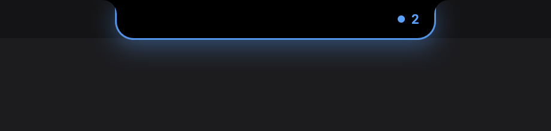
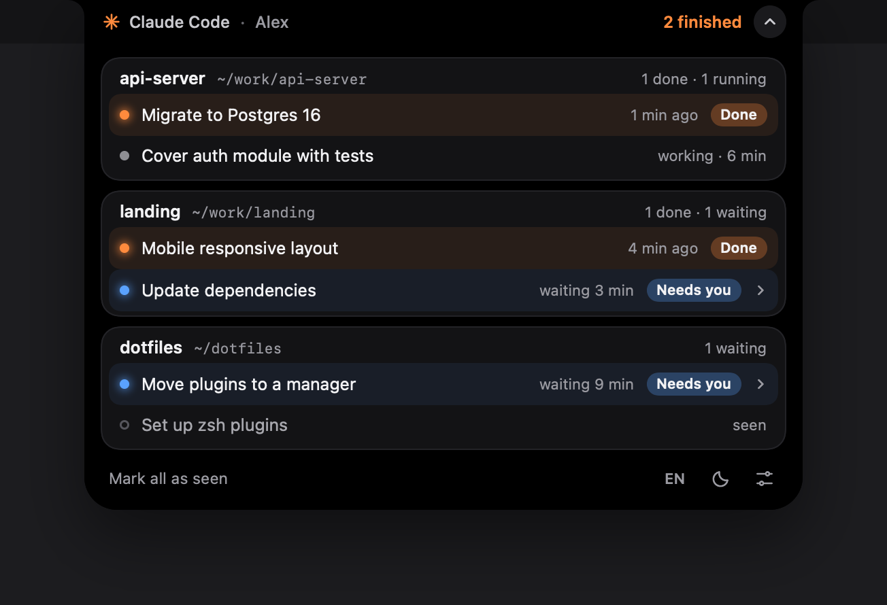
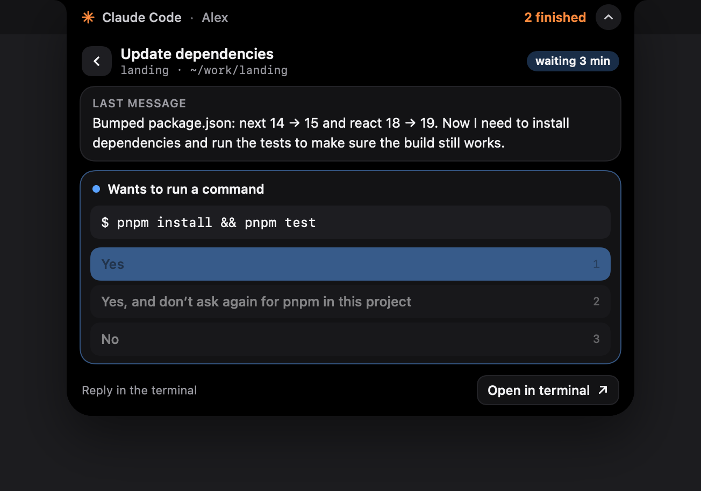
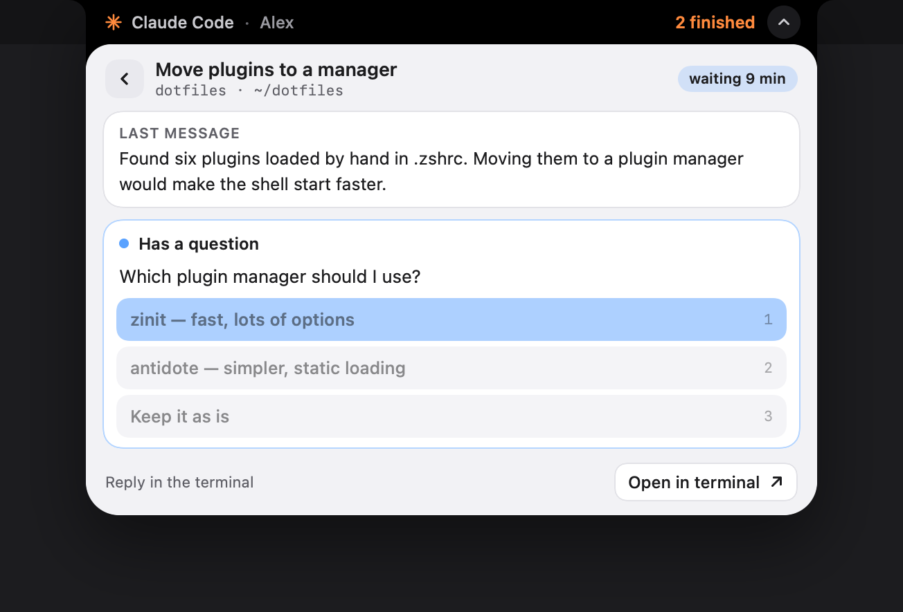
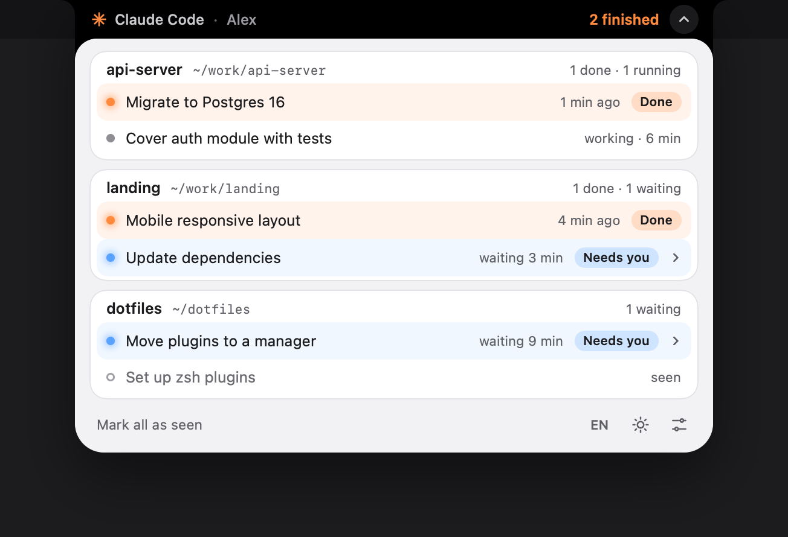
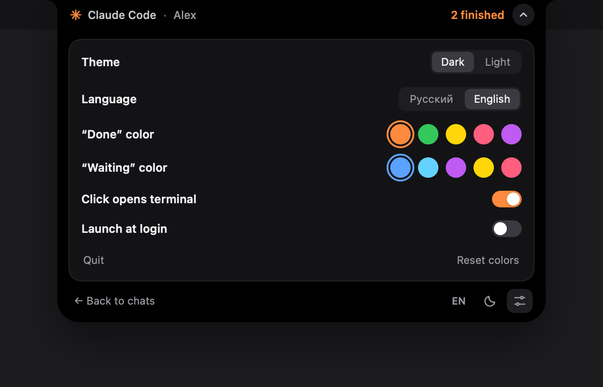

# Bangs

[](https://github.com/marksadpepe/bangs/actions/workflows/tests.yml)

**Your MacBook notch shows when Claude Code needs you.**

Bangs is a small macOS utility for people who run several [Claude Code](https://code.claude.com) sessions in parallel
Terminal tabs. When a chat finishes, the notch glows. When a chat is blocked on a permission prompt or a question, the
notch gets a blue outline. Click the notch and a panel slides out of it, listing every session grouped by project. One
more click takes you to the right Terminal tab.

<p align="center">
  
  
</p>

<p align="center">
  
</p>

> The screenshots are rendered by the app from its own SwiftUI views with demo data (`--render-previews`).

## Features

- **Notch indicator**
  - A soft, pulsing glow when chats have finished and you haven't looked at them yet.
  - A steady outline with a blinking counter when a chat is waiting for your answer.
  - The counter sits just right of the camera, because the notch area itself has no pixels.
  - On an external display without a notch, the app draws a matching pill at the top center.
- **Panel that grows out of the notch**
  - Chats are grouped into "islands" by project folder.
  - Each chat shows its status, how long it has been in that status, and its first message as the title.
  - Rows stay in place while the panel is open, so nothing jumps under your cursor.
  - Close the panel with Esc, a click outside it, or the collapse button.
- **Waiting chat screen**
  - Shows Claude's last message and exactly what it asks for: the command it wants to run (Bash, Edit, WebFetch…) or
    the question with its options.
  - **Open in terminal** (or Enter) takes you to the chat.
- **Jump to the Terminal tab**
  - Finds the Terminal.app tab by its tty and brings it to front.
  - If the tab is gone, opens a new window in the project folder and runs `claude --resume <session>`.
- **Statuses that match reality**
  - Approving a permission in the terminal flips the chat back to "working".
  - The "idle" reminder Claude Code sends after a minute does *not* count as "waiting".
  - Sessions whose `claude` process disappeared are cleaned up automatically.
- **Settings**: dark or light theme, Russian or English, "done" and "waiting" colors, click-to-jump, launch at login.
- **Multiple accounts**: shows the account name from `.claude.json` and supports separate `CLAUDE_CONFIG_DIR`s.
- **Lightweight and local**: no Dock icon, no third-party dependencies, and no network beyond `127.0.0.1`.
- Respects **Reduce Motion**.

<p align="center">
  
  
</p>

<p align="center">
  
  
</p>

## Chat statuses

| Status | Dot | When |
|---|---|---|
| Working | grey, pulsing | You sent a prompt and Claude is working |
| Done | "done" color + badge | Claude finished its turn. The notch glows until you look |
| Needs you | "waiting" color + badge | A permission prompt or a question (`AskUserQuestion`) is pending. It stays lit, even after you look at it, until you actually answer |
| Seen | hollow grey | Nothing to do |

Clicking a **done** chat marks it as seen and, by default, switches to its Terminal tab. Clicking a **waiting** chat
opens the waiting chat screen.

## How it works

```
Claude Code ──hook──▶ ~/.local/bin/notch-hook ──POST 127.0.0.1:47821/event──▶ Bangs.app
                              │                                                   ▲
                              └── app not running? ─▶ ~/Library/Application Support/Bangs/inbox/
```

1. Claude Code [hooks](https://code.claude.com/docs/en/hooks) call `notch-hook` on these events: `SessionStart`,
   `UserPromptSubmit`, `PermissionRequest`, `PreToolUse` (`AskUserQuestion` only), `PostToolUse`,
   `PostToolUseFailure`, `Notification`, `Stop`, `StopFailure` and `SessionEnd`.
2. The script adds context to the event:
   - the Terminal tab (`tty`);
   - the `claude` process ID;
   - the config dir and the project dir.
3. The script sends the event to the app over localhost. If the app is not running, it drops the event into an inbox
   folder instead, and the app picks it up on its next launch.
4. All hooks except `SessionEnd` are registered as `async`, so Claude Code never waits for them. The script has a
   1-second timeout and always exits 0.
5. The app turns events into chat statuses:
   - The chat title comes from the first prompt.
   - The pending command or question comes from the event.
   - Claude's last message is read from the session transcript.
   - State is saved to `~/Library/Application Support/Bangs/state.json`.
6. The jump to Terminal uses AppleScript. macOS asks once for permission to control Terminal.

## Requirements

- macOS 14 Sonoma or later. Built and tested on macOS 26 with a MacBook Air M2.
- Xcode **Command Line Tools** (`xcode-select --install`). Full Xcode is not needed.
- Claude Code with hook support. Tested with 2.1.x.
- Terminal.app, for jumping to tabs. Other terminals still get the notch and the panel.

## Install

```bash
git clone <this repo> Bangs && cd Bangs

# 1. Build and install the app into ~/Applications, then launch it
scripts/install-app.sh

# 2. Install the hook script and register hooks in ~/.claude/settings.json
#    (a timestamped backup of settings.json is made first; your other settings are kept)
scripts/install-hooks.sh

# If you use several accounts, pass each config dir:
scripts/install-hooks.sh ~/.claude ~/.claude-work
```

Then open the panel, go to **Settings**, and turn on **Launch at login**.

New `claude` sessions are picked up automatically. Sessions that were already running show up on their next event.

## Usage

| Action | How |
|---|---|
| Open the panel | Click the notch |
| Close the panel | Esc, click outside, or the ↑ button |
| Mark everything as seen | **Mark all as seen** at the bottom of the panel |
| Go to a chat's terminal | Click the chat, or **Open in terminal** / Enter on a waiting chat |
| Quit | **Settings → Quit**, or `pkill -x Bangs` |

## Uninstall

```bash
scripts/install-hooks.sh --uninstall      # removes only Bangs' hooks from settings.json
pkill -x Bangs
rm -rf ~/Applications/Bangs.app ~/.local/bin/notch-hook "$HOME/Library/Application Support/Bangs"
```

If you turned on launch at login, turn it off in the app's settings before removing the app.

## Development

```
Sources/Bangs/
  App/        entry point, app delegate, launch-at-login
  Model/      chats, statuses, settings, hook-event state machine, persistence, account
  Events/     localhost HTTP server, inbox watcher, hook event parsing, transcript reader
  Windows/    notch geometry, overlay panels, click-through and keyboard handling
  UI/         SwiftUI views: closed notch, panel, chat list, waiting chat, settings, theme, strings
  Terminal/   jump to a Terminal.app tab / resume a session
  Debug/      PNG renderer for screens
Tests/BangsTests/       Swift Testing suites
hooks/notch-hook        the hook script (bash + curl, optional jq)
scripts/                build-app, install-app, install-hooks, test
notch-app-handoff/      original spec (Russian) and design sources
```

Useful commands:

```bash
scripts/test.sh                                      # run the tests
swift build                                          # debug build
scripts/build-app.sh                                 # build/Bangs.app (ad-hoc signed)
open build/Bangs.app --args --mock --open            # demo data, panel open
.build/release/Bangs --render-previews previews      # render every screen to PNG
BANGS_PORT=47999 .build/debug/Bangs                  # run on a separate port for testing

# Send a fake event:
curl -X POST 127.0.0.1:47999/event -d '{"event":{"session_id":"t1","hook_event_name":"UserPromptSubmit","cwd":"/tmp","prompt":"Hello"}}'
```

### Tests

The tests use [Swift Testing](https://developer.apple.com/xcode/swift-testing/), which ships with the Command Line
Tools. XCTest does not, without Xcode. `scripts/test.sh` adds the framework search paths that SwiftPM misses without
Xcode. With Xcode installed, plain `swift test` works too.

| Suite | What it checks |
|---|---|
| Hook event parsing | Envelope fields, bare hook JSON, invalid input |
| State machine | Every hook event → status transition, idle notifications, `/clear`, same-tab restarts, dead-process cleanup |
| Panel model | Notch indicator, ordering and grouping, frozen order while open, tap / back / mark-all actions, texts |
| Transcript | First prompt and last assistant message extraction, titles and excerpts |
| Infrastructure | Local HTTP server (incl. large bodies), inbox fallback, account reader, settings persistence, notch geometry |
| Scripts | `notch-hook` end to end against a test server and the inbox fallback, and `install-hooks.sh` idempotency and clean uninstall. Both run in a temporary `HOME` |

The tests never touch your real `~/.claude` or the running app. They use temporary directories, in-memory settings and
random ports.

To sign with your own certificate, pass `SIGN_IDENTITY="<name>"` to `scripts/build-app.sh`. With the default ad-hoc
signature, macOS asks for Terminal automation permission again after every rebuild.

## Roadmap

- Answer permission prompts and questions right from the panel. The keys 1/2/3 are already shown. This needs a
  blocking `PermissionRequest` hook.
- A per-island account chip when several accounts are active.
- Support for terminals other than Terminal.app.
